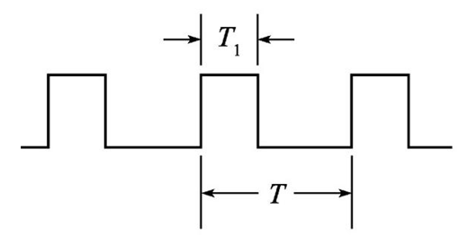
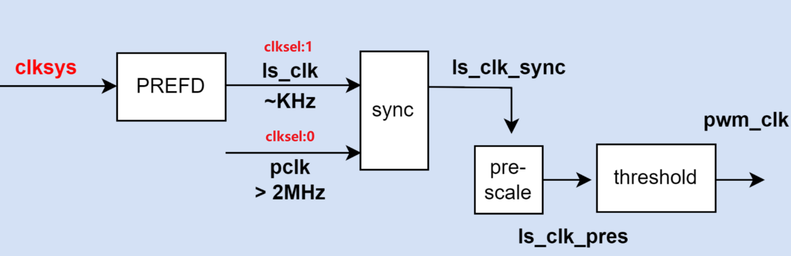

# Pulse Width Modulation (PWM)

## PWM Introduction

Pulse-width modulation (PWM) is a method for using pulse width to encode or modulate a signal. The width of each pulse is a function of the amplitude of the signal.

### Duty Cycle

The duty cycle is measured in percentage. The percentage duty cycle specifically describes the percentage of time a digital signal is on over an interval or period of time. This period is the inverse of the frequency of the waveform.



- **T:** `Tx_THRESHOLD` register configuration
- **T1:** `Tx_TH_CHANNELx` register configuration

### Clock Source

The PWM supports 2 different input sources, configured by the `Tx_CONFIG` registers. The clock gates are controlled by the `CG` register.



**Example:** how to generate a clock frequency of 5 Hz from the PWM output pin:

```ignore
T2_CONFIG    = (1 << 11) | (1 << 12) | (0x30 << 16);  // prescale 48, T2_CONFIG[11] = 0x1 (is_clk)
T2_PREFD     = 0x03E8 (1000)
T2_THRESHOLD = 0x64 (100)
```

- `ls_clk = 48 MHz / (2 × T2_PREFD) = 48 MHz / 2000 = 24 kHz`
- `ls_clk_pres = 24 kHz / 48 = 500 Hz`
- `pwm_clk = 500 Hz / 100 = 5 Hz`

## PWM Main Features

- 16-bit resolution
- Multiple pulse width output modes
- 4 timers for PWM
- 4 channels for every timer
- Each channel is independently configured with a duty cycle
- GPIO trigger mode:
  - Trigger event on input source rising edge
  - Trigger event on input source falling edge
  - Trigger event on input source falling or rising edge

## PWM Interrupts

The PWM module generates 4 events or interrupts:

- Event: the event signal is asserted when the counter reaches the threshold (TH) of the channel.
- Each timer independently generates an event.

PWM interrupts IRQn table:

| PWM | NVIC IRQn |
|-----|-----------|
| T0  | 140       |
| T1  | 141       |
| T2  | 142       |
| T3  | 143       |

## PWM Registers

Base address: `0x5012_0000`

| Register Name  | Offset | Size | Type   | Access | Default    | Description                              |
|----------------|--------|------|--------|--------|------------|------------------------------------------|
| T0_CMD         | 0x0000 | 32   | Config | R/W    | 0x00000000 | Command                                  |
| T0_CONFIG      | 0x0004 | 32   | Config | R/W    | 0x00000000 | Configuration                            |
| T0_THRESHOLD   | 0x0008 | 32   | Config | R/W    | 0x00000000 | Threshold configuration                  |
| T0_TH_CHANNEL0 | 0x000C | 32   | Config | R/W    | 0x00000000 | Channel 0 threshold configuration        |
| T0_TH_CHANNEL1 | 0x0010 | 32   | Config | R/W    | 0x00000000 | Channel 1 threshold configuration        |
| T0_TH_CHANNEL2 | 0x0014 | 32   | Config | R/W    | 0x00000000 | Channel 2 threshold configuration        |
| T0_TH_CHANNEL3 | 0x0018 | 32   | Config | R/W    | 0x00000000 | Channel 3 threshold configuration        |
| T0_COUNTER     | 0x002C | 32   | Status | R      | 0x00000000 | Counter                                  |
| T1_CMD         | 0x0040 | 32   | Config | R/W    | 0x00000000 | Command                                  |
| T1_CONFIG      | 0x0044 | 32   | Config | R/W    | 0x00000000 | Configuration                            |
| T1_THRESHOLD   | 0x0048 | 32   | Config | R/W    | 0x00000000 | Threshold configuration                  |
| T1_TH_CHANNEL0 | 0x004C | 32   | Config | R/W    | 0x00000000 | Channel 0 threshold configuration        |
| T1_TH_CHANNEL1 | 0x0050 | 32   | Config | R/W    | 0x00000000 | Channel 1 threshold configuration        |
| T1_TH_CHANNEL2 | 0x0054 | 32   | Config | R/W    | 0x00000000 | Channel 2 threshold configuration        |
| T1_TH_CHANNEL3 | 0x0058 | 32   | Config | R/W    | 0x00000000 | Channel 3 threshold configuration        |
| T1_COUNTER     | 0x006C | 32   | Status | R      | 0x00000000 | Counter                                  |
| T2_CMD         | 0x0080 | 32   | Config | R/W    | 0x00000000 | Command                                  |
| T2_CONFIG      | 0x0084 | 32   | Config | R/W    | 0x00000000 | Configuration                            |
| T2_THRESHOLD   | 0x0088 | 32   | Config | R/W    | 0x00000000 | Threshold configuration                  |
| T2_TH_CHANNEL0 | 0x008C | 32   | Config | R/W    | 0x00000000 | Channel 0 threshold configuration        |
| T2_TH_CHANNEL1 | 0x0090 | 32   | Config | R/W    | 0x00000000 | Channel 1 threshold configuration        |
| T2_TH_CHANNEL2 | 0x0094 | 32   | Config | R/W    | 0x00000000 | Channel 2 threshold configuration        |
| T2_TH_CHANNEL3 | 0x0098 | 32   | Config | R/W    | 0x00000000 | Channel 3 threshold configuration        |
| T2_COUNTER     | 0x00AC | 32   | Status | R      | 0x00000000 | Counter                                  |
| T3_CMD         | 0x00C0 | 32   | Config | R/W    | 0x00000000 | Command                                  |
| T3_CONFIG      | 0x00C4 | 32   | Config | R/W    | 0x00000000 | Configuration                            |
| T3_THRESHOLD   | 0x00C8 | 32   | Config | R/W    | 0x00000000 | Threshold configuration                  |
| T3_TH_CHANNEL0 | 0x00CC | 32   | Config | R/W    | 0x00000000 | Channel 0 threshold configuration        |
| T3_TH_CHANNEL1 | 0x00D0 | 32   | Config | R/W    | 0x00000000 | Channel 1 threshold configuration        |
| T3_TH_CHANNEL2 | 0x00D4 | 32   | Config | R/W    | 0x00000000 | Channel 2 threshold configuration        |
| T3_TH_CHANNEL3 | 0x00D8 | 32   | Config | R/W    | 0x00000000 | Channel 3 threshold configuration        |
| T3_COUNTER     | 0x00EC | 32   | Status | R      | 0x00000000 | Counter                                  |
| EVENT_CFG      | 0x0100 | 32   | Config | R/W    | 0x00000000 | Events configuration                     |
| CG             | 0x0104 | 32   | Config | R/W    | 0x00000000 | Channels clock gating configuration      |
| T0_PREFD       | 0x0140 | 32   | Config | R/W    | 0x00000000 | 32M clock frequency division for timer 0 |
| T1_PREFD       | 0x0144 | 32   | Config | R/W    | 0x00000000 | 32M clock frequency division for timer 1 |
| T2_PREFD       | 0x0148 | 32   | Config | R/W    | 0x00000000 | 32M clock frequency division for timer 2 |
| T3_PREFD       | 0x014C | 32   | Config | R/W    | 0x00000000 | 32M clock frequency division for timer 3 |

### Register Descriptions

#### Tx_CMD — Command Register

- **Address offset:** `0x00X0` (T0 X=0; T1 X=4; T2 X=8; T3 X=C)
- **Reset value:** `0x0000_0000`

| Bits | Field | Description          |
|------|-------|----------------------|
| [1]  | STOP  | Stop command bitfield  |
| [0]  | START | Start command bitfield |

#### Tx_CONFIG — Configuration Register

- **Address offset:** `0x00X4` (T0 X=0; T1 X=4; T2 X=8; T3 X=C)
- **Reset value:** `0x0000_0000`

| Bits    | Field      | Description                                                                                          |
|---------|------------|------------------------------------------------------------------------------------------------------|
| [23:16] | PRESC      | Prescaler value configuration. Value = actual value − 1                                              |
| [12]    | UPDOWNSEL  | Center-aligned mode configuration: `0` = the counter counts up and down alternately; `1` = the counter counts up and resets to 0 when reaching the threshold |
| [11]    | CLKSEL     | Clock source configuration: `0` = pclk, `1` = is_clk                                                 |
| [10:8]  | MODE       | Trigger mode configuration bitfield: `000` = trigger event at each clock cycle; `001` = trigger event if input source is 0; `010` = trigger event if input source is 1 |

#### Tx_THRESHOLD — Threshold Configuration Register

- **Address offset:** `0x00X8` (T0 X=0; T1 X=4; T2 X=8; T3 X=C)
- **Reset value:** `0x0000_0000`

| Bits    | Field | Description                                                        |
|---------|-------|---------------------------------------------------------------------|
| [31:16] | TH_HI | Threshold high part configuration bitfield. It defines the end counter value. |
| [15:0]  | TH_LO | Threshold low part configuration bitfield. It defines the start counter value. |

> **Note:** Value = actual value − 1

#### Tx_TH_CHANNEL0 — Channel 0 Threshold Configuration Register

- **Address offset:** `0x00XC` (T0 X=0; T1 X=4; T2 X=8; T3 X=C)
- **Reset value:** `0x0000_0000`

| Bits    | Field | Description                                                                                                              |
|---------|-------|---------------------------------------------------------------------------------------------------------------------------|
| [18:16] | MODE  | Channel 0 threshold match action on channel output signal configuration bitfield: `000` = set; `001` = toggle, then next threshold match action is clear; `010` = set, then next threshold match action is clear; `011` = toggle; `100` = clear; `101` = toggle, then next threshold match action is set; `110` = clear, then next threshold match action is set |
| [15:0]  | TH    | Channel 0 threshold configuration bitfield. Value = actual value − 1                                                     |

#### Tx_TH_CHANNEL1 — Channel 1 Threshold Configuration Register

- **Address offset:** `0x00X0` (T0 X=1; T1 X=5; T2 X=9; T3 X=D)
- **Reset value:** `0x0000_0000`

| Bits    | Field | Description                                                                                                              |
|---------|-------|---------------------------------------------------------------------------------------------------------------------------|
| [18:16] | MODE  | Channel 1 threshold match action on channel output signal configuration bitfield: `000` = set; `001` = toggle, then next threshold match action is clear; `010` = set, then next threshold match action is clear; `011` = toggle; `100` = clear; `101` = toggle, then next threshold match action is set; `110` = clear, then next threshold match action is set |
| [15:0]  | TH    | Channel 1 threshold configuration bitfield. Value = actual value − 1                                                     |

#### Tx_TH_CHANNEL2 — Channel 2 Threshold Configuration Register

- **Address offset:** `0x00X4` (T0 X=1; T1 X=5; T2 X=9; T3 X=D)
- **Reset value:** `0x0000_0000`

| Bits    | Field | Description                                                                                                              |
|---------|-------|---------------------------------------------------------------------------------------------------------------------------|
| [18:16] | MODE  | Channel 2 threshold match action on channel output signal configuration bitfield: `000` = set; `001` = toggle, then next threshold match action is clear; `010` = set, then next threshold match action is clear; `011` = toggle; `100` = clear; `101` = toggle, then next threshold match action is set; `110` = clear, then next threshold match action is set |
| [15:0]  | TH    | Channel 2 threshold configuration bitfield. Value = actual value − 1                                                     |

#### Tx_TH_CHANNEL3 — Channel 3 Threshold Configuration Register

- **Address offset:** `0x00X8` (T0 X=1; T1 X=5; T2 X=9; T3 X=D)
- **Reset value:** `0x0000_0000`

| Bits    | Field | Description                                                                                                              |
|---------|-------|---------------------------------------------------------------------------------------------------------------------------|
| [18:16] | MODE  | Channel 3 threshold match action on channel output signal configuration bitfield: `000` = set; `001` = toggle, then next threshold match action is clear; `010` = set, then next threshold match action is clear; `011` = toggle; `100` = clear; `101` = toggle, then next threshold match action is set; `110` = clear, then next threshold match action is set |
| [15:0]  | TH    | Channel 3 threshold configuration bitfield. Value = actual value − 1                                                     |

#### Tx_COUNTER — Counter Register

- **Address offset:** `0x00XC` (T0 X=2; T1 X=6; T2 X=A; T3 X=E)
- **Reset value:** `0x0000_0000`

| Bits    | Field   | Description                              |
|---------|---------|--------------------------------------------|
| [31:0]  | Counter | Read: value of the T0/1/2/3 counter      |

#### EVENT_CFG — Events Configuration Register

- **Address offset:** `0x0100`
- **Reset value:** `0x0000_0000`

| Bits    | Field    | Description                                                                                     |
|---------|----------|---------------------------------------------------------------------------------------------------|
| [19]    | EN3      | Enable T3 event generation                                                                      |
| [18]    | EN2      | Enable T2 event generation                                                                      |
| [17]    | EN1      | Enable T1 event generation                                                                      |
| [16]    | EN0      | Enable T0 event generation                                                                      |
| [15:12] | T3chsel  | T3 event source selection configuration bitfield: `0xC` = T3 channel 0; `0xD` = T3 channel 1; `0xE` = T3 channel 2; `0xF` = T3 channel 3 |
| [11:8]  | T2chsel  | T2 event source selection configuration bitfield: `0x8` = T2 channel 0; `0x9` = T2 channel 1; `0xA` = T2 channel 2; `0xB` = T2 channel 3 |
| [7:4]   | T1chsel  | T1 event source selection configuration bitfield: `0x4` = T1 channel 0; `0x5` = T1 channel 1; `0x6` = T1 channel 2; `0x7` = T1 channel 3 |
| [3:0]   | T0chsel  | T0 event source selection configuration bitfield: `0x0` = T0 channel 0; `0x1` = T0 channel 1; `0x2` = T0 channel 2; `0x3` = T0 channel 3 |

#### CG — Channels Clock Gating Configuration Register

- **Address offset:** `0x0104`
- **Reset value:** `0x0000_0000`

| Bits   | Field | Description                                                              |
|--------|-------|----------------------------------------------------------------------------|
| [3:0]  | en    | Clock gating configuration bitfield: `0` = clock gated, `1` = enabled. Bit[0] = T0 configuration; Bit[1] = T1 configuration; Bit[2] = T2 configuration; Bit[3] = T3 configuration |

#### Tx_PREFD — Clock Frequency Division Configuration Register

- **Address offset:** `0x014X` (T0 X=0; T1 X=4; T2 X=8; T3 X=C)
- **Reset value:** `0x0000_0000`

| Bits   | Field   | Description                                                        |
|--------|---------|----------------------------------------------------------------------|
| [9:0]  | CLK_FD  | 32 MHz clock frequency division: `0`, `1` = no division. Value = actual value − 1 |
